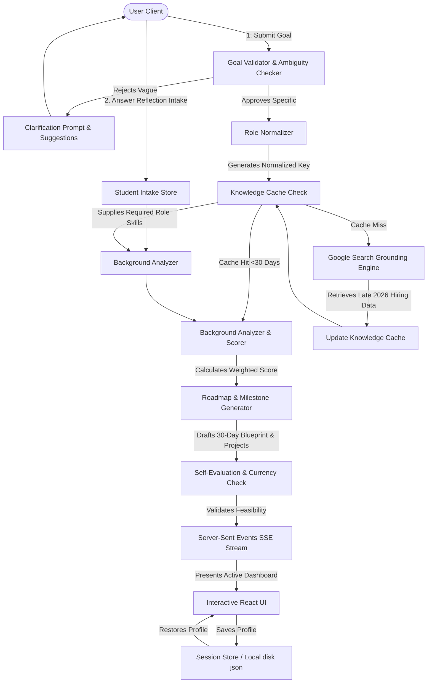
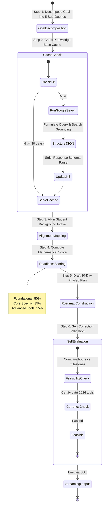
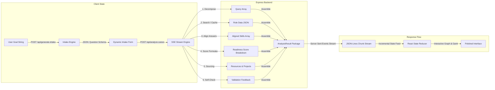

<p align="center">
  
</p>

<h1 align="center">🚀 CareerPilot AI</h1>

<p align="center">
  <strong>An Agentic Career Intelligence & Learning Roadmap System powered by Gemini AI and Live Google Search Grounding.</strong>
</p>

<p align="center">
  <a href="https://github.com/ashnegi2222/CareerPilot-AI/actions"></a>
  <a href="https://github.com/ashnegi2222/CareerPilot-AI/blob/main/LICENSE"></a>
  <a href="https://typescriptlang.org"></a>
  <a href="https://react.dev"></a>
  <a href="https://ai.google.dev"></a>
  <a href="https://expressjs.com"></a>
</p>

---

## 📖 Table of Contents

- [🛑 Problem Statement](#-problem-statement)
- [🤖 Why AI Agents?](#-why-ai-agents)
- [✨ Key Features](#-key-features)
- [🧭 Overall Architecture](#-overall-architecture)
- [⚙️ Agentic Workflow](#%EF%B8%8F-agentic-workflow)
- [📊 System Data Flow](#-system-data-flow)
- [🛠️ Tech Stack](#%EF%B8%8F-tech-stack)
- [📂 Project Structure](#-project-structure)
- [🚀 Quick Start & Installation](#-quick-start--installation)
- [💾 Grounded Knowledge Cache](#-grounded-knowledge-cache)
- [🎯 Weighted Readiness Score Formula](#-weighted-readiness-score-formula)
- [🔒 Security & Guardrails](#-security--guardrails)
- [🔮 Future Enhancements](#-future-enhancements)
- [🤝 Contributing](#-contributing)
- [📄 License](#-license)
- [✍️ Author](#%EF%B8%8F-author)

---

## 🛑 Problem Statement

Aspiring software engineers, students, and career changers face a daunting barrier: **rapidly shifting hiring landscapes.** Conventional career guidance is static, generic, and quickly becomes obsolete. Online learning paths recommend outdated frameworks, fail to evaluate a candidate's background honestly, and do not factor in personal logistical constraints like weekly study hour budgets. This results in wasted study hours, misalignment with current hiring requirements, and severe imposter syndrome.

---

## 🤖 Why AI Agents?

Traditional single-prompt LLM interactions fail to deliver reliable, structured, and factually accurate roadmap recommendations. They suffer from:
1. **Knowledge Cutoffs**: Inability to recognize late-breaking industry demands (e.g. late 2026 stack shifting).
2. **Hallucinated Resources**: Inventing non-existent Udemy courses or Coursera specializations.
3. **Black-box Scoring**: Randomly assigning a "9/10 readiness match" without mathematical explanation.

**CareerPilot AI** addresses this by transitioning the career advising experience into a **multi-stage agentic system**. By dividing the reasoning pipeline into modular, validated stages (Decomposition, Grounded Search, Intake Alignment, Mathematical scoring, Roadmap compilation, and Constraint Self-Check), the system minimizes error propagation, enforces rigid schemas, guarantees real-world citation grounding, and delivers an exceptionally structured blueprint.

---

## ✨ Key Features

- **🔍 Adaptive Ambiguity & Goal Check**: Evaluates user career goals with a gatekeeping model; vague suggestions are intercepted with helpful clarifications and recommendations for concrete alternative roles.
- **📋 Dynamic Background Intake**: Dynamically generates tailored assessment questions based on the selected career track, mapping out existing skillsets and hours available for study.
- **📡 Active Google Search Grounding**: Formulates multi-aspect research queries and uses live Google Search to pull verified Late 2026 hiring metrics, complete with interactive source citations.
- **🧠 Zero-Latency Knowledge Cache**: Stores freshly researched roles in a local knowledge base (`career_knowledge_base.json`). Hits within 30 days bypass rate-limited live searches, keeping responses snappy.
- **🔢 50/35/15 Weighted Scoring**: Evaluates current student readiness using a transparent mathematical formula: **50% Foundational**, **35% Core specific**, and **15% Advanced tools**.
- **📅 30-Day Phased Roadmap**: Compiles a highly detailed timeline split into 4 logical phases, custom-fitted with hands-on portfolio projects and actionable milestones.
- **🛡️ Agentic Self-Evaluation Pass**: Runs a final validation check on its own output, verifying that the milestone workload is reasonable for the user's weekly study budget and certifying that suggested technologies are modern.
- **📡 Server-Sent Events (SSE)**: Streams agent reasoning progress to the client in real-time, displaying status, diagnostic log details, and final payloads.
- **💾 Profile Session Persistence**: Saves and restores historical student profile roadmaps through local file persistence using custom login identifiers.

---

## 🧭 Overall Architecture

The diagram below details how the multi-layered agent components interact to validate, research, score, and evaluate a student's career trajectory.



---

## ⚙️ Agentic Workflow

Each invocation of the analysis engine executes a sequential **6-Step Reasoning Pipeline**, streaming the intermediate thought logs directly to the user's browser.



---

## 📊 System Data Flow

Data flows seamlessly through structured schemas and strict JSON interfaces from raw user input to the final rich React state tree.



---

## 🛠️ Tech Stack

| Technology | Category | Role in Architecture |
| :--- | :--- | :--- |
| **Gemini 3.5 Flash** | AI Engine | Powers multi-stage logical evaluations, formatting, and analysis. |
| **Google Search Grounding** | Grounding Tool | Connects model reasoning to live web content for late-2026 demand data. |
| **React 19** | Frontend Framework | Renders dynamic dashboards, cards, and state tracking. |
| **TypeScript** | Language | Enforces strict, compile-time type safety across frontend and backend. |
| **Tailwind CSS v4** | Styling | Delivers an immersive, sleek cosmic slate interface design. |
| **Express / Node.js** | Server Platform | Powers API routing, caching systems, and streaming mechanisms. |
| **Server-Sent Events** | Stream Protocol | Delivers logs and results incrementally to prevent browser timeouts. |
| **JSON Cache** | Data Store | Implements zero-dependency file-based cache systems. |
| **Cloud Run** | Deployment | Serves the containerized system with scale-to-zero capabilities. |

---

## 📂 Project Structure

```text
├── assets/                       # Static public assets and banners
├── src/
│   ├── components/
│   │   ├── Header.tsx            # Navigation and profile loading controls
│   │   └── CareerRoadmap.tsx     # The primary dashboard visualizer (Score, timeline, checklists)
│   ├── App.tsx                   # Main React entry point & SSE controller
│   ├── index.css                 # Global styles and Tailwind configuration
│   ├── main.tsx                  # Vite browser bootstrap
│   └── types.ts                  # Shared compile-time TypeScript interface definitions
├── server.ts                     # Full-stack Express server (Gemini API pipeline and SSE)
├── career_knowledge_base.json    # Local JSON database for role search cache
├── sessions.json                 # Local JSON database for profile persistence
├── .env.example                  # Environment template
├── tsconfig.json                 # TS Compiler rules
├── package.json                  # Dependencies and execution scripts
└── README.md                     # Documentation
```

---

## 🚀 Quick Start & Installation

### Prerequisites
Ensure you have the following installed locally:
- **Node.js** (v18.0 or higher)
- **npm** (v9.0 or higher)

### Setup & Installation

1. **Clone the Repository:**
   ```bash
   git clone https://github.com/ashnegi2222/CareerPilot-AI.git
   cd CareerPilot-AI
   ```

2. **Install Dependencies:**
   ```bash
   npm install
   ```

3. **Configure Environment Variables:**
   Create a `.env` file in the root directory by copying the template:
   ```bash
   cp .env.example .env
   ```
   Open `.env` and configure your **Gemini API Key**:
   ```env
   GEMINI_API_KEY=AIzaSyYourActualKeyGoesHere...
   ```

4. **Boot Local Server:**
   ```bash
   npm run dev
   ```
   The development server will mount. Open [http://localhost:3000](http://localhost:3000) in your browser.

5. **Build for Production:**
   To compile and package the app for deployment (bundling Express and React):
   ```bash
   npm run build
   npm run start
   ```

---

## 💾 Grounded Knowledge Cache

To prevent rate limits and speed up user interactions, CareerPilot AI implements a smart caching layer in `server.ts`. 

Whenever a career goal is submitted, the role is normalized (e.g. "Full Stack Dev" resolves to `full-stack-developer`). The system checks `career_knowledge_base.json` first:
- **Hit (< 30 days old)**: Instantly loads the cached profile.
- **Miss (or > 30 days old)**: Triggers the live Google Search grounding engine, formats the response with strict schemas, and updates the local database.

This strategy ensures high-fidelity career data with incredibly low response times!

---

## 🎯 Weighted Readiness Score Formula

Our dynamic readiness score is calculated using a robust, deterministic mathematical formula mapping raw background answers to extracted industry metrics:

$$\text{Readiness Score} = \left( \frac{F_{\text{matched}}}{F_{\text{total}}} \times 50 \right) + \left( \frac{C_{\text{matched}}}{C_{\text{total}}} \times 35 \right) + \left( \frac{A_{\text{matched}}}{A_{\text{total}}} \times 15 \right)$$

Where:
* $F$ = Foundational Skills (50% weight). Prerequisite languages and core computer science fundamentals.
* $C$ = Core Professional Skills (35% weight). Target frameworks, libraries, and active standards.
* $A$ = Advanced Specialized Skills (15% weight). Niche architectural topics, scaling, and systems design.

As students check off missing skills on their interactive roadmap, the score recalculates in **real-time** on the frontend, visually charting their progress toward employment!

---

## 🔒 Security & Guardrails

- **🛡️ Prompt Injection Shielding**: All inputs undergo length constraints and a sanitization check at Step 1, rejecting hijacking commands.
- **🛡️ Structural JSON Schemas**: Every Gemini call uses `@google/genai`'s `responseSchema` to completely block malformed Markdown outputs.
- **🛡️ Lazy SDK Instantiation**: The Google Gen AI SDK is initialized on demand, ensuring that missing server-side keys don't crash container builds on startup.
- **🛡️ Try-Catch Fallbacks**: Parsing issues or streaming blockages fail gracefully, falling back to high-fidelity local templates rather than disrupting user sessions.

---

## 🔮 Future Enhancements

- [ ] **Firestore Database Integration**: Upgrade the local JSON store to durable cloud persistence for multi-device login sessions.
- [ ] **Google Calendar API sync**: Auto-export weekly study milestones to the user's real Google Calendar.
- [ ] **Interactive Code Playgrounds**: Embed interactive coding playgrounds directly inside Phase 1 foundational checklist cards.
- [ ] **Continuous PDF Resume Export**: Offer dynamic resume compilation matching updated roadmap readiness profiles.

---

## 🤝 Contributing

Contributions are highly valued! Please help make CareerPilot AI even better:
1. Fork the Repository.
2. Create a feature branch: `git checkout -b feature/AmazingFeature`
3. Commit changes: `git commit -m 'Add some AmazingFeature'`
4. Push to branch: `git push origin feature/AmazingFeature`
5. Open a Pull Request.

---

## 📄 License

Distributed under the MIT License. See `LICENSE` for more details.

---

## ✍️ Author

**Ash Negi**
- Email: [ashnegi2222@gmail.com](mailto:ashnegi2222@gmail.com)
- GitHub: [@ashnegi2222](https://github.com/ashnegi2222)
- Devapp Link: [Live App Preview](https://ais-dev-o4kuzntbf54aflixzvu3z4-910967307641.asia-east1.run.app)
